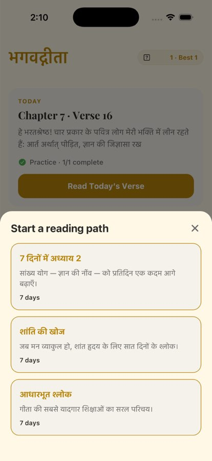

# BUG-001 — "Guided paths" does nothing on Android

| | |
|--|--|
| **Priority** | P1 |
| **Platform** | Android (iOS works) |
| **Area** | Home |
| **Status** | not a bug — loop [24]: sheet opens on Android when tapped on a settled screen |
| **Found** | 2026-10-03, `main` @ baf77be, debug build on `Medium_Phone_API_36` (API 36) |
| **Estimate** | M |

## User impact
Guided paths ("Chapter 2 in 7 days", "Seeking peace", "Foundational
verses") are the app's main habit-building feature, and the Home link is the
only way in. On Android the link is dead, so Android users can never start a
path.

## Steps to reproduce
1. Fresh install on Android, complete onboarding.
2. Home → scroll so "Chapters" header is visible.
3. Tap **"0% Guided paths ›"** (right side of the Chapters header).

**Expected:** bottom sheet "Start a reading path" with three paths (as on iOS).
**Actual:** nothing happens. Tapped twice (on "Guided paths ›" and on the
row centre); no sheet, no navigation, no console error observed.

## Evidence
Android after tap — still Home: 
iOS after same tap — sheet opens: 

## Likely cause (unconfirmed)
`app/(main)/index.tsx:407` — `<Pressable onPress={() => setPathPickerOpen(true)}>`
renders `PathPickerModal` (`components/practice/PathPickerModal.tsx`) at
`index.tsx:561`. Since iOS works, suspect either:
- the `Pressable` is not receiving the touch on Android (overlapping view,
  `hitSlop` vs. a sibling's bounds, `pointerEvents` on a parent), or
- the modal opens but renders off-screen/zero-height on Android (Modal +
  Reanimated/`statusBarTranslucent`/`navigationBarTranslucent` interaction).

First step: add a temporary `console.log` in `onPress` and in the modal's
render, and watch Metro logs while tapping, to tell these apart.

## Task
1. Determine which of the two causes it is (log above; `adb shell uiautomator
   dump` shows whether the modal's views exist after tap).
2. Fix the root cause, not with an Android-only workaround if the same
   structure is fragile on iOS.
3. Check the other Home modals that use the same pattern (Surprise,
   Practice calendar, Widget nudge) on Android while there.

## Acceptance criteria
- [ ] Android: tapping "Guided paths ›" opens the path picker within 300 ms.
- [ ] Picking a path starts it and Home shows "Path · Day 1 of 7 · …".
- [ ] iOS behaviour unchanged.
- [ ] Surprise and streak-calendar modals verified on Android too.

## Verification
```bash
adb -s emulator-5554 shell am start -W -a android.intent.action.VIEW -d "bagavadgita://" com.bhagavadgita.android
shots/ui.sh | grep -i "guided"     # tap point
adb -s emulator-5554 shell input tap <x> <y>
adb -s emulator-5554 exec-out screencap -p > shots/a-paths.png
```
Screenshot both platforms with the sheet open, and after starting a path.

## Out of scope
Redesigning where Guided paths lives on Home (tracked separately as a UX item).

## Notes (loop [10])
- Web: works (sheet opens) — verified live in loop [1].
- iOS: works (walkthrough).
- `PathPickerModal` uses a plain `<Modal transparent animationType="slide">`
  rendered at the screen root (`app/(main)/index.tsx`), not inside the list
  header — nothing Android-specific in the code path.
- The original Android repro tapped right after `adb shell input swipe`
  scrolls; on Android a tap during fling momentum only stops the scroll.
  **Re-test first, tapping after the list has settled**, before changing code.
  Needs the Android debug build (≥ 8 GB free disk).

## Resolution (loop [24])
Re-tested on the Android debug build (Medium_Phone_API_36) per the notes:
waited for the list to settle, tapped "0% Guided paths ›" via its uiautomator
bounds — "Start a reading path" opened with all three paths. The original
repro tapped right after `adb shell input swipe`, during fling momentum, where
Android consumes the tap to stop the scroll. No code change.
