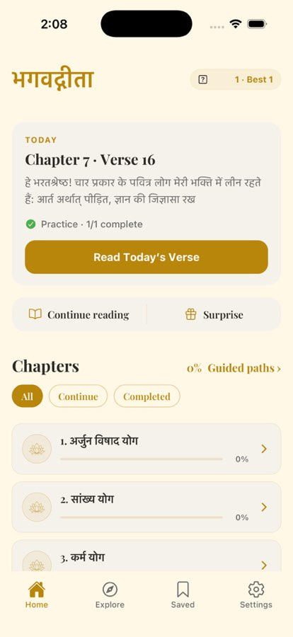

# BUG-003 — iOS streak chip shows a "?" box instead of 🔥

| | |
|--|--|
| **Priority** | P2 |
| **Platform** | iOS (Android correct) |
| **Area** | Home |
| **Status** | fixed — loop [7], verified on iOS Simulator (Ionicons flame) |
| **Found** | 2026-10-03, iOS 26.3 Simulator, iPhone 17 Pro |
| **Estimate** | S |

## User impact
The streak is the app's core retention signal and sits top-right on Home,
the most-seen screen. On iOS it shows a missing-glyph box, which reads as
broken on every launch.

## Steps to reproduce
1. iOS, any language, Home.
2. Look at the top-right streak chip.

**Expected:** "🔥 1 · Best 1".
**Actual:** "[?] 1 · Best 1" (tofu box). Empty-looking in dark theme.

## Evidence
 — compare Android: 

## Likely cause (unconfirmed)
`app/(main)/index.tsx:520` renders `<Text style={styles.streakFlame}>🔥</Text>`;
`streakFlame` (line 615) sets only size/lineHeight, so the font is probably
inherited from a parent or a global default (Playfair Display / custom
`Text` defaults) that has no emoji glyph, and iOS does not fall back the way
Android does here. Check for a global `Text.defaultProps` / Paper theme font.

## Task
Prefer replacing the emoji with an icon from `@expo/vector-icons`
(`Ionicons "flame"`, tinted `colors.primary` or a warm accent) — consistent
rendering, theme-aware colour. If keeping the emoji, set the system font
explicitly on that `Text`.

## Acceptance criteria
- [ ] iOS light + dark: flame visible, aligned with the text baseline.
- [ ] Android unchanged.
- [ ] Accessibility label still "Open reading calendar…".

## Verification
`xcrun simctl openurl <udid> "bagavadgita://"`, screenshot in light and
dark (`xcrun simctl ui <udid> appearance dark`).

## Out of scope
Making the calendar / long-press share discoverable (separate UX item).
