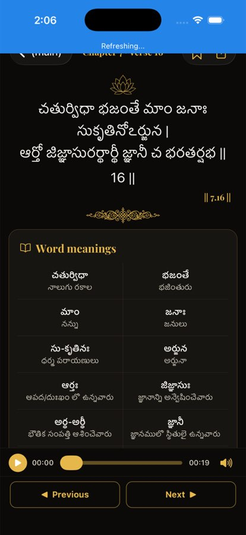

# BUG-004 — iOS back button reads "(main)"

| | |
|--|--|
| **Priority** | P2 |
| **Platform** | iOS |
| **Area** | Verse (and any screen pushed from the tabs) |
| **Status** | fixed — loop [1], verified on iOS Simulator in loop [7] (chevron only) |
| **Found** | 2026-10-03, iOS 26.3 Simulator |
| **Estimate** | S |

## User impact
Every verse opened from Home shows a back button labelled "(main)" — an
internal Expo Router group name. It's the first thing in the top-left of the
most-used screen and looks unfinished.

## Steps to reproduce
1. iOS, Home → **Read Today's Verse** (or any chapter → verse).

**Expected:** back chevron alone, or a meaningful title ("Home"/"Chapter 7").
**Actual:** "‹ (main)".

## Evidence

## Likely cause
`app/_layout.tsx:254` — `<Stack.Screen name="(main)" options={{ headerShown: false }} />`
gives no `title`, so the native stack uses the route name as the back title
for the next screen.

## Task
Set `title` (e.g. `"Home"`) on the `(main)` screen, or set
`headerBackButtonDisplayMode: "minimal"` / `headerBackTitle` on pushed
screens (verse, chapter, path, explore category) so iOS shows a chevron only.
Pick one approach for all pushed screens; match Android, which shows an arrow
only.

## Acceptance criteria
- [ ] Verse, Chapter, Path, Explore-category screens on iOS show no "(main)".
- [ ] Swipe-back gesture still works.
- [ ] Android unchanged.

## Verification
`xcrun simctl openurl <udid> "bagavadgita://verses/2-47"` and screenshot;
also open a chapter from Home and screenshot.

## Out of scope
Restyling the header.
