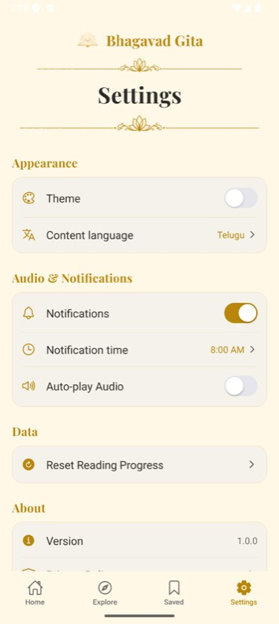

# BUG-006 — Android status-bar icons invisible in light theme

| | |
|--|--|
| **Priority** | P3 |
| **Platform** | Android (iOS correct) |
| **Area** | Global |
| **Status** | fixed — loop [10], verified on Android emulator in loop [24] (dark icons on cream) |
| **Found** | 2026-10-03, API 36 emulator |
| **Estimate** | S |

## User impact
In the light (cream) theme the clock, battery and signal icons stay white,
so they disappear on the cream background on every screen.

## Steps to reproduce
1. Android, Settings → turn Theme off (light).
2. Look at the status bar.

**Expected:** dark status-bar content on light theme, light on dark.
**Actual:** white icons on cream.

## Evidence

## Likely cause
No `StatusBar` component is rendered anywhere in `app/` or `components/`,
so Android keeps the launch default (light content, from the dark splash)
while iOS adapts automatically.

## Task
Render `<StatusBar style={isDark ? "light" : "dark"} />` from `expo-status-bar`
once, in `app/_layout.tsx`, driven by `useAppTheme()`. Add `expo-status-bar`
via `npx expo install` if not already a dependency. Check onboarding (always
dark) still gets light content.

## Acceptance criteria
- [ ] Android light theme: dark status-bar icons on all tabs and pushed screens.
- [ ] Android dark theme + onboarding: light icons.
- [ ] Toggling theme updates the bar without restart.

## Verification
Screenshot Home and a Verse screen on Android in both themes.

## Out of scope
Edge-to-edge / navigation-bar colour.
