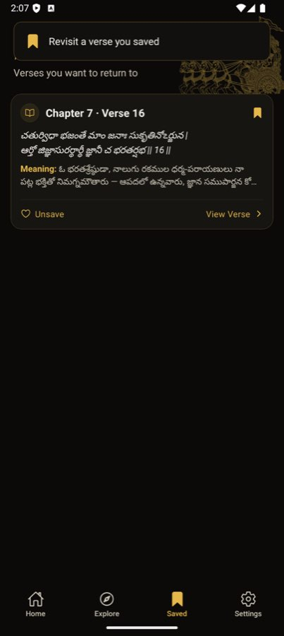

# BUG-007 — Saved: toast covers the title; Unsave uses a heart

| | |
|--|--|
| **Priority** | P3 |
| **Platform** | Both |
| **Area** | Saved |
| **Status** | fixed — loop [4], verified live |
| **Found** | 2026-10-03 |
| **Estimate** | S |

## User impact
Opening the Saved tab shows a toast "Revisit a verse you saved" that sits on
top of the screen title, so the first thing seen is an overlay hiding the
page name. The toast says nothing the screen doesn't already say ("Verses
you want to return to"). Separately, saving uses a **bookmark** icon but the
card's Unsave button uses a **heart**, so the two don't read as the same
action.

## Steps to reproduce
1. Save any verse (bookmark icon on the Verse screen).
2. Open the Saved tab.

**Expected:** title "Saved" visible; Unsave uses the bookmark metaphor.
**Actual:** toast over title; heart icon on Unsave.

## Evidence

## Likely cause
`app/(main)/saved.tsx:77` — `showToast("Revisit a verse you saved", "info", "bookmark")`
fires on focus/mount.

## Task
1. Remove that toast (it carries no information). If it was meant as a
   first-visit hint, show it once ever, below the header, not over it.
2. Change the Unsave icon to `bookmark` (filled → outline on press) to match
   the Verse screen.

## Acceptance criteria
- [ ] Opening Saved never overlays the title.
- [ ] Unsave icon matches the save icon family; Unsave still works and the
      list updates immediately.

## Verification
Save a verse, open Saved on both platforms, screenshot; tap Unsave, screenshot
the empty state.

## Out of scope
Saved empty-state design (separate UX item).
