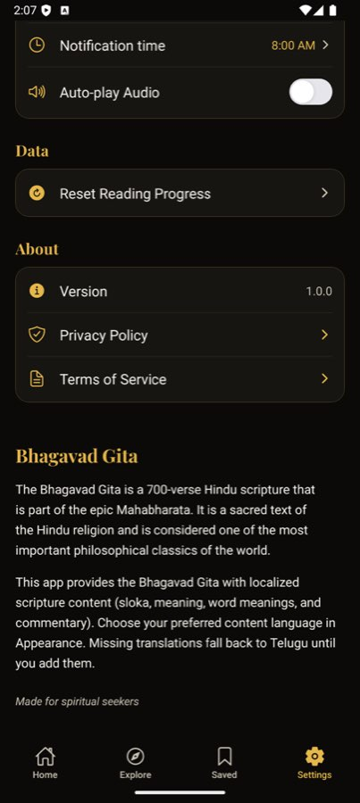

# BUG-008 — Developer-facing and stale copy shown to readers

| | |
|--|--|
| **Priority** | P3 |
| **Platform** | Both |
| **Area** | Settings, Onboarding |
| **Status** | fixed — loop [6], verified live (onboarding copy fixed in [3]) |
| **Found** | 2026-10-03 |
| **Estimate** | S |

## User impact
Small lines of copy written for the developer, or left over from when the
app was Telugu-only, tell readers the app is unfinished.

## Instances
| Where | Current | Problem |
|--|--|--|
| Settings → About, `app/(main)/settings.tsx:~475` | "Missing translations fall back to Telugu until you add them." | "you" is the developer |
| Onboarding page 2, `app/onboarding.tsx:102` | "…all 18 chapters with Telugu translations…" | App has 4 languages (see BUG-002) |
| Settings → Appearance → Theme | toggle with no state label | User can't tell on = dark |

## Evidence

## Task
1. About: replace with reader-facing copy, e.g. "Where a translation isn't
   available yet, the Telugu text is shown."
2. Onboarding page 2: name all four languages (coordinate with BUG-002).
3. Theme: show the current state as text ("Dark"/"Light"), or replace the
   toggle with a Light / Dark / System segmented control (preferred — the
   app already follows the system on first run, and the toggle can't
   express that).
4. `git grep -n "you add\|TODO\|Lorem"` in `app/` and `components/` for
   other user-visible developer copy.

## Acceptance criteria
- [ ] No user-visible string addresses the developer.
- [ ] Theme setting's current value is readable without toggling it.

## Verification
Screenshot Settings (top and About) and onboarding page 2 on both platforms.

## Out of scope
Rewriting all onboarding copy (separate UX item on onboarding length).
