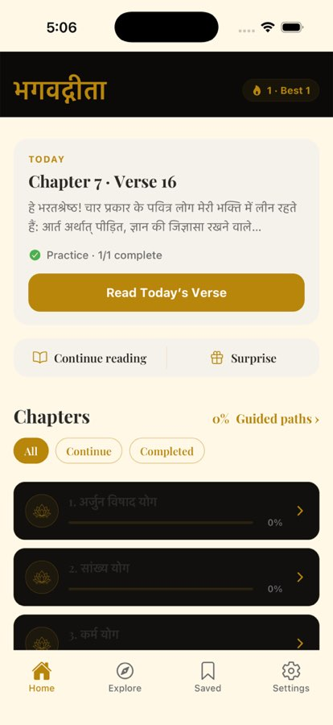

# BUG-011 — Light theme: Home header and chapter cards stay dark

| | |
|--|--|
| **Priority** | P1 |
| **Platform** | iOS confirmed (Simulator); likely all — check Android + web |
| **Area** | Home |
| **Status** | fixed — loop [24] (re-fix); verified Android, web, and iOS Simulator cold start (loop [26]) |
| **Found** | 2026-10-03, loop [7] |
| **Estimate** | M |

## User impact
With the light theme saved, a cold start shows Home with a **black header
strip** behind the title and **black chapter cards with dark text** — the
chapter list, the main way into the scripture, is close to unreadable. The
rest of the screen (Today card, buttons, tab bar) is correctly light.

## Steps to reproduce
1. Settings → Dark mode **off** (light theme).
2. Kill the app, relaunch (or reload JS).
3. Look at Home.
**Expected:** cream header and cream chapter cards with dark text.
**Actual:** header band and chapter cards in the dark palette.

## Evidence

## Likely cause (unconfirmed)
`ThemeProvider` starts as `"dark"` and loads the saved theme asynchronously.
Parts of Home are memoised (`useMemo`/`useCallback` for the list header and
`renderChapterTile`, sticky header) and probably don't list `colors` (or
`isDark`) in their dependencies — so they keep the first-render dark palette.
The Android runtime toggle looked right in the walkthrough because toggling
re-renders everything that does depend on `colors`.

## Task
1. Audit `app/(main)/index.tsx` memo dependency arrays; include `colors`
   wherever styles read it (also the FlatList `extraData`).
2. Consider not rendering Home until the theme has loaded, to avoid a
   dark→light flash on every cold start.
3. Check the same pattern on Explore, Saved, Chapter screens.

## Acceptance criteria
- [ ] Cold start in light theme: header + chapter cards are light (iOS, Android, web).
- [ ] Toggling theme at runtime still updates everything.
- [ ] No dark→light flash at launch.

## Verification
iOS Simulator dev build via Metro (`exp+bagavadgita://expo-development-client/?url=…8081`),
light theme, reload, screenshot Home; web: set theme light, refresh.

## Re-fix (loop [24])
The loop [8] fix (ThemeProvider renders `null` until the saved theme loads)
**left the Android app blank**: Expo Router's root layout must mount its
navigator on the first render; with the tree withheld, the root view
remounted in a loop (gesture-handler init/teardown every ~20 ms). It only
looked fine on iOS/web by timing. Reverted the gate. Instead, the two
surfaces that kept their first-render colours — the `entering`-animated
brand bar and the chapter FlatList rows — are keyed on the palette
(`brand-${bg}`, `chapters-${bg}`) so they remount when the saved theme
arrives. Verified: Android cold start in light theme — brand bar and all
chapter cards cream; no duplicate-key warning; web light cold start tiles
cream; 12-route sweep ok.
